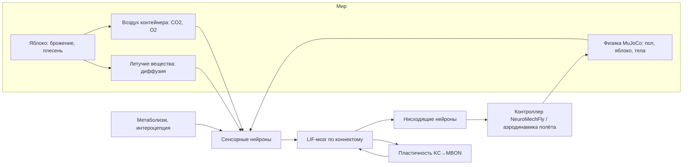

<h1 align="center">Fly-Sim</h1>

<p align="center">
<b>Оцифрованные дрозофилы, гниющее яблоко и воздух вокруг — поведение управляется симуляцией коннектомов, а каждое приближение задокументировано.</b><br>
Спайковые модели целого мозга <i>Drosophila</i> в реалистичных телах, с физикой, метаболизмом, обучением и размножением.<br>
Работает на ноутбуке, один контейнер, настройка в браузере.
</p>

<p align="center">


</p>

<p align="center"><b>Русский</b> · <a href="README.en.md">English</a></p>

---

## Оглавление

- [Что это](#что-это)
- [Что моделируется](#что-моделируется)
  - [Нервные системы](#нервные-системы) · [Органы чувств](#органы-чувств) · [Тело и физика](#тело-и-физика) · [Мир](#мир) · [Обучение и размножение](#обучение-и-размножение)
- [Быстрый старт](#быстрый-старт)
- [Как пользоваться сайтом](#как-пользоваться-сайтом)
- [Логи](#логи)
- [Эксперименты](#эксперименты)
- [Научная честность](#научная-честность)
- [Архитектура](#архитектура)
- [Производительность](#производительность)
- [Данные и источники](#данные-и-источники)
- [Структура репозитория](#структура-репозитория)
- [Релизы](#релизы)

## Что это

Fly-Sim помещает одну или несколько *Drosophila melanogaster* с полными, независимо
симулируемыми нервными системами рядом с яблоком, которое бродит, превращается в уксус и
плесневеет, — внутри контейнера, воздух в котором меняется, потому что яблоко и мухи дышат.
Поведение ничем не скриптуется: мухи видят, чуют, пробуют, слышат и чувствуют только через
сенсорные нейроны, которые есть в коннектоме, и двигаются только через нисходящие нейроны с
экспериментально известной функцией. Голод, еда, избегание, ухаживание, агрессия, обучение и
откладка яиц должны возникнуть из проводки.

Каждое отклонение модели от измеренных данных записано с источником в
[ASSUMPTIONS.md](ASSUMPTIONS.md); что пока не работает — в [KNOWN_ISSUES.md](KNOWN_ISSUES.md);
границы модели — в [MODEL_SCOPE.md](MODEL_SCOPE.md); что проверено — в
[SCIENTIFIC_VALIDATION.md](SCIENTIFIC_VALIDATION.md); как ставить опыты — в
[EXPERIMENT_DESIGN.md](EXPERIMENT_DESIGN.md).

Каждый результат помечен режимом: `connectome_only` (только реконструированные пути),
`connectome_plus_approximations` (плюс задокументированные приближения) или
`experimental_shortcuts` (есть обходы по физиологии). Режим, версия модели, ID эксперимента и
полнота нервной системы каждой мухи сохраняются в `manifest.json`.

## Что моделируется

### Нервные системы

| | Самка (эталон) | Самка (полная ЦНС, экспериментально) | Самец |
|---|---|---|---|
| Коннектом | FlyWire v783 (Dorkenwald et al. 2024) | BANC 888 (Bates et al. 2025) | Janelia Male CNS v1.0 |
| Что входит | мозг + зрительные доли | мозг + зрительные доли + брюшная нервная цепочка (VNC) | **полная ЦНС:** мозг + зрительные доли + брюшная нервная цепочка (VNC) |
| Нейроны / связи | 138 639 / 15,1 млн | 181 627 / 13,6 млн | 164 587 / 25,6 млн |
| Статус | проверена на опубликованных результатах | пока не эквивалентна FlyWire | проверена после калибровки |
| Модель нейрона | LIF (Shiu et al. 2024), событийный симулятор на Numba | то же, вес синапса откалиброван между датасетами (×1/1,78 по 7220 общим типам) |

Симулятор повторяет эталон Brian2 **спайк в спайк** (9054 из 9054 спайков за 1 с) и в ~8 раз
быстрее. Артефакты точечной модели, загонявшие опубликованную модель в самоподдерживающийся
режим «горит всё», убраны задокументированными биологическими поправками: медиаторы по известной
идентичности и типу клеток, нет быстрых моноаминовых синапсов, нет запуска спайков через
аксо-аксонные синапсы на сенсорные нейроны и клетки Кеньона.

### Органы чувств

| Чувство | Входит в мозг через | Физический стимул |
|---|---|---|
| Обоняние | 2275–2635 ORN по клубочкам, профили DoOR | диффузия 30+ летучих веществ фрукта, CO₂, геосмин, cVA самцов |
| Вкус | лабеллярные GRN (сахар, вода, горечь, Ir94e, соль) | химия поверхности и осмолярность яблока |
| Зрение | 3900–8800 фоторецепторов (гистамин), по колонкам глаза | трассировка лучей: яблоко и другие мухи |
| Температура | термосенсоры усиков; кандидаты в ноцицепторы ног у самца | температура тела из теплообмена с воздухом и полом |
| Слух | орган Джонстона, JO-B | песня ухаживания вблизи |
| Интероцепция | инсулин-производящие клетки, чувствительность от голода | зоб, сахар гемолимфы, энергия |

### Тело и физика

- **Тело для ходьбы:** NeuroMechFly v2 (Wang-Chen et al. 2024) в MuJoCo — 6 ног, 42 привода,
  гравитация, трение, сцепление лапок, контакты лапок с полом и яблоком, столкновения мух.
  Нисходящие нейроны коннектома управляют двухканальным контроллером NeuroMechFly.
- **Полёт и падение:** квазистационарная аэродинамика (сила крыльев ∝ амплитуде², сопротивление,
  гравитация); без взмахов — свободное падение с предельной скоростью ~3 м/с.
- **Тепло:** теплообмен тела массой 1 мг с воздухом и, через лапки, с полом.
- **Моторная цепочка (самец, BANC):** мозг → нисходящие нейроны → VNC → мотонейроны мышц ног →
  активация мышц → суставы NeuroMechFly, с обратной связью от проприоцепторов ног. Ритм шага
  пока даёт генератор NeuroMechFly: коннектомная VNC его не создаёт (A81).
- **Ноцицепция:** жар пола под конкретной лапкой возбуждает сенсорные нейроны этой ноги в
  брюшной нервной цепочке (у BANC — размеченные мультидендритные, у самца — кандидаты).
- **Схема тела:** состояние каждой ноги, крыльев, усиков и глаз плюс измеренная функция; травмы
  задаёт экспериментатор, организм о них «не знает».

### Мир

- **Яблоко:** двухстадийное брожение (дрожжи → спирт + CO₂ + эфиры; уксуснокислые бактерии →
  уксус), синяя плесень (*Penicillium expansum*: геосмин, патулин), целое или надрезанное,
  зависимость от температуры (Q10) и кислорода.
- **Несколько яблок** со своими возрастом, надрезом, размером и местом; размер мира задаётся в
  метрах (от садка 0,1 м до комнаты 5 м).
- **Семена и деревья:** семена высвобождаются из сгнившего плода; прорастают только после
  холодной стратификации (~75 дн при 1–7 °C) в почве и влаге; сеянец растёт, через ~6 лет
  дерево плодоносит и роняет новые яблоки. При постоянных 25 °C дерево не вырастет — как в жизни.
- **Сезоны (опция):** умеренный климат; зимой мухи в холодовой коме.
- **Воздух:** контейнер — хорошо перемешанный объём газа с вентиляцией; брожение, плесень,
  бактерии и мухи меняют CO₂ и O₂ по стехиометрии. Закрытая банка становится бескислородной,
  проветриваемый садок — нет.

### Обучение и размножение

- **Память:** зависящая от дофамина и порядка событий пластичность синапсов клетки Кеньона → MBON
  (запах→наказание ослабляет, наказание→запах усиливает; Handler et al. 2019), с забыванием.
- **Жизненный цикл:** песня ухаживания и готовность самки исходят из мозгов; спаривание снижает
  возбудимость pC1 (половой пептид), откладку яиц запускают oviDN; яйца → личинки → куколки →
  новые взрослые мухи со своими мозгами (~9,5 сут при 25 °C). Плесень и уксус снижают выживание
  личинок.

## Быстрый старт

**Docker** (рекомендуется):

```bash
docker compose up --build
```

Откройте http://localhost:8800. При первом запуске скачается ~0,7 ГБ открытых данных коннектомов
в `./data`. Выделите Docker Desktop не меньше 6 ГБ памяти.

**Локально** (macOS / Linux, Python 3.12):

```bash
uv venv --python 3.12 .venv && uv pip install -e ".[validate]"
```

```bash
scripts/download_data.sh && .venv/bin/python -m flysim.live
```

## Как пользоваться сайтом

1. **Условия** — размер мира в метрах, сезоны, почва, кислород, CO₂, температура, объём
   контейнера и вентиляция, список яблок (возраст, надрез, размер, место), травмы и схема тела, число самцов и самок, голод, горячая зона на полу, научные контроли
   (обучение вкл/выкл, «короткий путь» наказания, спонтанная ходьба), длина сессии и перемотка
   суток. У каждого параметра подписана норма.
2. **Наблюдение** — кнопки «+ самец / + самка» во время симуляции, арена, мозг каждой мухи целиком (каждый нейрон на реальном месте, вспыхивает
   при спайке), внутреннее состояние, химия яблока относительно нормы и живая лента событий.
3. **Логи** — скачать всё одним архивом.

Сессии считаются нейрон за нейроном (около 1/20 реального времени для пары); между сессиями мир
перематывается: яблоко гниёт, воздух меняется, мухи голодают, яйца развиваются, вылупляются
взрослые.

## Логи

| Файл | Содержимое |
|---|---|
| `events.txt`, `events.jsonl` | что, когда и с кем произошло: где муха, еда, жар, запахи, контакты, песня, спаривание, яйца, сигналы награды и наказания, изменения памяти, рождения, смерти |
| `timeseries.csv` | каждые 0,1 с для каждой мухи: положение, состояние, голод, энергия, зоб, температура, запах и вкус, частоты ключевых нейронов, PPL1 (наказание), PAM (награда), сила памяти |
| `apple.csv` | сахар, спирт, уксус, дрожжи, бактерии, плесень, летучие вещества, яйца/личинки/куколки |
| `config.json` | условия прогона |

> Частоты нейронов награды и наказания — **функциональные нейронные корреляты** ценности стимула,
> а не измерение субъективного переживания.

## Эксперименты

`scripts/run_all.sh` запускает лабораторные парадигмы с контролями и пишет `REPORT.md`:

| Вопрос | Парадигма | Контроли |
|---|---|---|
| Выбор после неприятного опыта, сохранение памяти | T-лабиринт запах + наказание (Tully & Quinn 1985), тесты через 0–3 ч | без пластичности, без «короткого пути» наказания, только рефлексы |
| Избегание места неприятного стимула | горячая зона пола (Ofstad et al. 2011) | без пластичности |
| Поиск еды после наказания | время до плода, извилистость пути, время на плоде | без пластичности |
| Конфликт «еда или жар» | тёплое кольцо вокруг бродящего плода, голодные и сытые | — |
| Ухаживание и драки | самец + самка, два самца у яблока | — |
| Интеграция сенсорики, устойчивость состояний | пробы на мозге без тела | — |

## Научная честность

- Различия самца и самки FlyWire нельзя считать половыми без поправки на разную полноту
  нервной системы (у самки FlyWire нет VNC) — см. MODEL_SCOPE.md.
- Серии с повторами, 95 % ДИ, размером эффекта и расчётом мощности: `scripts/series.py`.

- Поведение никогда не скриптуется; моторные *примитивы* (выпад, копуляция) запускаются только
  активностью мозга и записаны как допущения.
- Путь от болевых стимулов тела к дофаминовым нейронам наказания коннектомная модель **не**
  воспроизводит; используется измеренная физиология, и всегда считается контроль без неё.
- Рефлексы стабилизации полёта (жужжальца, VNC) — рефлекторный слой; ходьба — полная физика.
- Потомки получают коннектом родителя: существует только один коннектом каждого пола.
- Метакогниция не моделируется; возможные индикаторы (задержка решения, колебания) только
  отслеживаются.

## Архитектура



## Производительность

Apple M2, 8 ГБ: один мозг ≈ 1,7 с счёта на 1 с модельного времени; пара с телами NeuroMechFly ≈
18 с на 1 с. В память помещается до 4–6 мух с мозгами.

## Данные и источники

FlyWire v783 (Dorkenwald et al. 2024; Schlegel et al. 2024) через Shiu et al. 2024 · Janelia Male
CNS v1.0 (CC-BY) · Matsliah et al. 2024 (колонки глаза) · DoOR (Münch & Galizia 2016) ·
NeuroMechFly v2 (Wang-Chen et al. 2024). Полный список с числами — в
[ASSUMPTIONS.md](ASSUMPTIONS.md).

## Структура репозитория

```
flysim/brain      спайковый симулятор, пластичность, сборка мозга
flysim/data       загрузчики коннектомов и разметки
flysim/agent      органы чувств, метаболизм, моторика, тела, физика, муха
flysim/world      яблоко, атмосфера, популяция, мир
flysim/sim        эксперименты, запись, журнал событий
flysim/live       сайт (сервер + страница)
flysim/viz        экспорт офлайн-просмотрщика
scripts           загрузка данных, эксперименты, отчёт, проверки
```

## Релизы

| Версия | Что внутри |
|---|---|
| 0.2.0 | Методология (режимы механизмов, манифест, протоколы, статистика), полная моторная цепочка, самка BANC, схема тела и травмы, несколько яблок, деревья, сезоны |
| 0.1.0 | Мозги по коннектомам (оба пола), реалистичные тела, физика, гниющее яблоко, атмосфера, обучение, размножение, сайт, логи, Docker |
