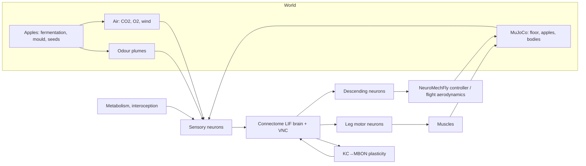

<h1 align="center">Fly-Sim</h1>

<p align="center">
<b>Whole-connectome fruit flies in physical bodies, living next to rotting apples.</b><br>
Spiking models of complete <i>Drosophila</i> nervous systems drive NeuroMechFly bodies in MuJoCo; the world has fermenting and moulding fruit, air chemistry, seasons, seeds and trees.<br>
Configured, run and inspected in the browser. Every approximation is documented.
</p>

<p align="center">


</p>

<p align="center"><b>English</b> · <a href="README.ru.md">Русский</a></p>

---

## Contents

- [What it is](#what-it-is)
- [What is simulated](#what-is-simulated)
- [Quick start](#quick-start)
- [Using the web app](#using-the-web-app)
- [Experiments and statistics](#experiments-and-statistics)
- [Logs and data](#logs-and-data)
- [Scientific status](#scientific-status)
- [Architecture](#architecture)
- [Performance](#performance)
- [Data, references, license](#data-references-license)
- [Repository layout](#repository-layout)
- [Releases](#releases)

## What it is

Fly-Sim simulates *Drosophila melanogaster* whose behaviour is driven by spiking simulations of
their complete reconstructed nervous systems. Flies sense the world only through sensory neurons
that exist in the connectome and act only through descending and motor neurons with known
functions. Hunger, feeding, avoidance, learning, mating, egg laying, ageing and death are meant to
arise from the wiring, the body and the environment — not from scripts.

Where data are missing, the model uses documented approximations, each listed with its source in
[ASSUMPTIONS.md](ASSUMPTIONS.md). Every result is labelled with a **mechanism mode**:
`connectome_only`, `connectome_plus_approximations` or `experimental_shortcuts`.
See [MODEL_SCOPE.md](MODEL_SCOPE.md) for what is and is not modelled,
[SCIENTIFIC_VALIDATION.md](SCIENTIFIC_VALIDATION.md) for what has been checked, and
[KNOWN_ISSUES.md](KNOWN_ISSUES.md) for open problems.

## What is simulated

### Nervous systems

| | Female | Male | Reference (not a fly in the world) |
|---|---|---|---|
| Connectome | BANC 888 | Janelia Male CNS v1.0 | FlyWire v783 |
| Contains | brain + optic lobes + ventral nerve cord | brain + optic lobes + ventral nerve cord | brain + optic lobes |
| Neurons / connections | 181,627 ids (≈145k effective; glia, trachea, unannotated ids and neurons without a transmitter call are silenced) / 13.6 M | 164,587 (≈163.6k effective) / 25.6 M | 138,639 / 15.1 M |
| Calibration | per cell type to FlyWire (brain) / Male CNS (VNC) | per cell type to FlyWire (brain), ×1/1.78 (VNC) | Shiu et al. 2024, validated spike for spike |

Both sexes have a complete central nervous system. FlyWire is used to validate the simulator
and to calibrate cell types; it is not placed in the world. Calibration is a fit: it rescales
neurons per type and so suppresses sex differences in input strength; the neurons used as test
read-outs (MN9, PPL1, PAM, MBONs, tested PNs) are held out of it (A09f,
`scripts/calibration_report.py`).

- **Neuron model:** leaky integrate-and-fire (Shiu et al. 2024), event-driven and parallel; it
  reproduces the published Brian2 model spike for spike.
- **Biological corrections:** transmitters from known identity and cell-type consensus; no fast
  synapses for dopamine, serotonin and octopamine; no spike drive through axo-axonic synapses onto
  sensory neurons and Kenyon cells. Without them the published model falls into a self-sustaining
  state.
- **Learning:** dopamine-gated, timing-dependent plasticity at Kenyon cell → MBON synapses
  (forward pairing depresses, backward pairing potentiates), with forgetting.

### Senses

Smell (2,000+ olfactory receptor neurons with DoOR response profiles, CO₂, geosmin, male cVA,
wind-borne plumes), taste (labellar sugar, water, bitter, salt classes; osmolarity-gated water
cells), vision (photoreceptors mapped to eye columns, ray-cast scene), temperature (antennal
hot/cold cells and body heat), hearing (Johnston's organ, courtship song), wind (Johnston's organ
wind neurons), proprioception and leg nociception (full-CNS flies), interoception (insulin cells,
hunger-dependent gain).

### Body and physics

- **NeuroMechFly v2 in MuJoCo:** six legs, 42 actuated joints, gravity, friction, tarsal adhesion,
  contacts with the floor and every apple, fly–fly collisions.
- **Motor chain (full-CNS flies):** descending neurons → VNC → leg motor neurons → muscle activation
  → joints, with proprioceptive feedback. The stepping rhythm comes from NeuroMechFly's CPG because
  the connectome VNC does not produce one (documented).
- **Flight:** quasi-steady aerodynamics, drag, gravity and free fall; stabilisation is a reflex
  layer.
- **Heat:** body temperature from exchange with air and floor.
- **Body schema and lesions:** state and measured function of every leg, wing, antenna and eye.

### World

Several apples (age, cut/intact, size, position) that ferment, turn to vinegar and mould;
container air (CO₂/O₂ mass balance from fruit, microbes, soil and flies, with ventilation);
still air in a container or a **garden climate** (sun position and light for 50° N, day and
night, daily temperature cycle, Markov weather from clear to storm, ground-level wind with
gusts); seasons; soil; apple seeds that need cold stratification before they germinate, then grow
into seedlings and fruiting trees; a life cycle from egg to adult; individual mortality
(Gompertz ageing, starvation, heat, cold, anoxia, mould toxin).

## Quick start

**Docker**

```bash
docker compose up --build
```

Open http://localhost:8800. The page opens at once; on the first start about 1.2 GB of public
connectome data download into `./data` in the background (progress on the home page and in
`data/download.log`), and runs can start when it is done. Give Docker at least 6 GB of memory.

**NVIDIA GPU** (driver + NVIDIA Container Toolkit on the host): the brain runs on the GPU.

```bash
docker compose -f docker-compose.yml -f docker-compose.gpu.yml up --build
```

Locally: `uv pip install -e ".[cuda]"` and `FLYSIM_BACKEND=cuda` (default `auto` picks the GPU when
one is present). `scripts/check_cuda.py --bench female_banc` compares GPU and CPU and reports the
speed; `scripts/validate_all.py` runs the correctness checks.

**Local** (Python 3.12, macOS or Linux)

```bash
uv venv --python 3.12 .venv && uv pip install -e ".[validate]"
```

```bash
scripts/download_data.sh && .venv/bin/python -m flysim.live
```

## Using the web app

1. **Observations** (home): every running and saved run. Several runs can work at once; each can be
   opened in its own browser tab; finished runs can be deleted.
2. **New observation:** choose a *free simulation* (world size in metres, seasons, soil, wind, air,
   climate, apples, flies, injuries, scientific controls, optional time limits) or a
   *prepared experiment* (protocol, group, seed).
3. **Observation:** arena (darker at night, wind arrow), weather and air readouts, every fly's whole brain (each neuron at its real position), internal
   state, body schema, apple chemistry with reference values. While running you can add flies and
   apples. Any moment can be replayed.
4. **Chronicle (god panel):** a timeline of everything detected — fights, courtship, mating, eggs,
   births and deaths with causes, feeding, punishment and reward signals (neural correlates),
   memory changes, apple stages, air alarms, plants. Filter, expand, copy, jump to the moment.
   Each event shows which brain regions dominated and how signal flowed between regions. Region
   dominance over time per fly.
5. **Passports:** every fly has a unique ID, origin and parents, nervous-system coverage, mechanism
   mode, individual tolerances and life history.

Without a limit, a free simulation runs until life in the world ends: no adult flies and no brood
left.

## Experiments and statistics

```bash
.venv/bin/python scripts/series.py list
```

```bash
.venv/bin/python scripts/series.py plan tmaze_choice 10
```

```bash
.venv/bin/python scripts/series.py run tmaze_choice 10 --proc 8
```

Protocols declare a hypothesis, groups and controls (no plasticity, no shortcuts, reflexes only).
The analysis reports means, 95 % confidence intervals, Cohen's d, Welch and Mann–Whitney tests,
and the replicates needed for 80 % power. Each run is reproducible from its experiment ID and
`manifest.json`. See [EXPERIMENT_DESIGN.md](EXPERIMENT_DESIGN.md).

## Logs and data

Every run directory (`results/runs/<id>/`) contains `frames.jsonl` (the full history: positions
every 0.1 s, whole-brain spikes every second and around events), `events.jsonl`/`events.txt`,
`timeseries.csv` (states, neural readouts, motor commands and body movement), `apple.csv` and
`manifest.json` (model version, mechanism mode, connectome coverage, conditions). Reward and
punishment rates are functional neural correlates, not measurements of experience.

## Scientific status

Validated: spike-exact reproduction of the reference model; sugar → feeding motor neuron and
bitter suppression; network stability; CO₂ activates punishment dopamine neurons innately;
hunger increases feeding in closed loop (a test of the hand-set sugar-receptor gain A14 and proboscis threshold, not an emergent property); timing-dependent plasticity; BANC female close to the FlyWire
reference on sugar, odour and stability tests; noxious leg input reaches punishment dopamine neurons through the full
CNS. Differences between datasets are diagnosed, not tuned away: the male's CO₂ → punishment
dopamine path is silent because of its wiring, and bitter suppresses feeding less in BANC
(KNOWN_ISSUES #6). Open: courtship and aggression have not yet emerged; the VNC produces no stepping rhythm;
the stability of the antennal lobe depends on one probably wrong transmitter label
(KNOWN_ISSUES #5). Metacognition is not added as a separate module: if flies have it, it would
have to arise from the simulated connectome itself, so only candidate indicators are tracked.

## Architecture



## Performance

On an 8-core laptop CPU: one brain ≈ 1.7 s of compute per simulated second; a pair of flies with
NeuroMechFly bodies ≈ 15–20 s per simulated second. Memory ≈ 0.4 GB per fly. Replicated series
scale with the number of processes.

## Data, references, license

Code: MIT ([LICENSE](LICENSE)). Data are downloaded from their sources and keep their own licenses
([NOTICE.md](NOTICE.md)): FlyWire (Dorkenwald et al. 2024; Schlegel et al. 2024), Shiu et al. 2024,
Janelia Male CNS v1.0, BANC (Bates et al. 2025), Matsliah et al. 2024, DoOR (Münch & Galizia 2016),
NeuroMechFly v2 (Wang-Chen et al. 2024).

## Repository layout

```
flysim/brain      spiking simulator, plasticity, brain factory and calibration
flysim/data       FlyWire, BANC and Male CNS loaders, annotations
flysim/agent      senses, metabolism, motor readout, motor chain, bodies, physics, mortality, fly
flysim/world      apples, atmosphere, weather, plants, population, world
flysim/sim        experiments, protocols, chronicle, event log, provenance
flysim/live       web app (Lit components in flysim/live/static)
scripts           data download, validation, series, probes
```

## Releases

| Version | Content |
|---|---|
| 0.4.0 | Female always with full CNS (BANC), garden climate (day/night, weather, gusty wind), redesigned web app (Lit), deleting runs, aligned brain views, dataset discrepancies diagnosed, scientific audit |
| 0.3.0 | Multi-run web app with god panel (chronicle, region dynamics, passports), prepared experiments from the browser, BANC female calibrated per cell type, pain pathway through the full CNS, individual mortality and natural end, wind and soil respiration, MIT license |
| 0.2.0 | Mechanism modes and provenance, protocols and statistics, male motor chain, BANC female, body schema, several apples, trees, seasons |
| 0.1.0 | Connectome brains, NeuroMechFly bodies, physics, rotting apple, atmosphere, learning, reproduction, web app, Docker |
