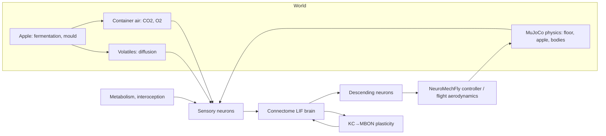

<h1 align="center">Fly-Sim</h1>

<p align="center">
<b>Two digitized fruit flies, a rotting apple and the air around them — every decision comes from a simulated connectome.</b><br>
Whole-brain spiking models of <i>Drosophila</i> in realistic bodies, with physics, metabolism, learning and reproduction.<br>
Runs on a laptop, one container, configured in the browser.
</p>

<p align="center">


</p>

<p align="center"><b>English</b> · <a href="README.ru.md">Русский</a></p>

---

## Table of contents

- [What this is](#what-this-is)
- [What is simulated](#what-is-simulated)
  - [Nervous systems](#nervous-systems) · [Senses](#senses) · [Body and physics](#body-and-physics) · [World](#world) · [Learning and reproduction](#learning-and-reproduction)
- [Quick start](#quick-start)
- [Using the web app](#using-the-web-app)
- [Logs](#logs)
- [Experiments](#experiments)
- [Scientific honesty](#scientific-honesty)
- [Architecture](#architecture)
- [Performance](#performance)
- [Data and references](#data-and-references)
- [Repository structure](#repository-structure)
- [Releases](#releases)

## What this is

Fly-Sim places one or more *Drosophila melanogaster* with complete, independently simulated nervous
systems next to an apple that ferments, turns to vinegar and grows mould, inside a container whose air
changes as the apple and the flies breathe. Nothing about behaviour is scripted: the flies only see,
smell, taste, hear and feel through sensory neurons that exist in the connectome, and they only move
through descending neurons with experimentally known motor functions. Hunger, feeding, avoidance,
courtship, aggression, learning and egg laying have to emerge from the wiring.

Every place where the model departs from measured data is written down with its source in
[ASSUMPTIONS.md](ASSUMPTIONS.md); what does not work yet is in [KNOWN_ISSUES.md](KNOWN_ISSUES.md).

## What is simulated

### Nervous systems

| | Female | Male |
|---|---|---|
| Connectome | FlyWire v783 brain (Dorkenwald et al. 2024) | Janelia Male CNS v1.0: brain + optic lobes + ventral nerve cord |
| Neurons / connections | 138,639 / 15.1 M | 164,587 / 25.6 M |
| Neuron model | Leaky integrate-and-fire (Shiu et al. 2024), event-driven, Numba | same, synaptic weight calibrated across datasets (×1/1.78, 7,220 matched cell types) |

The simulator reproduces the published Brian2 reference **spike for spike** (9,054 of 9,054 spikes in 1 s)
and about 8× faster. Point-neuron artefacts that drove the published model into a self-sustaining
"everything on" state were removed with documented biological corrections (transmitters resolved by
known identity and cell type, no fast monoamine synapses, no spike drive through axo-axonic
synapses onto sensory neurons and Kenyon cells).

### Senses

| Sense | Enters the brain through | Physical stimulus |
|---|---|---|
| Smell | 2,275–2,635 ORNs by glomerulus, DoOR response profiles | diffusion of 30+ fruit volatiles, CO₂, geosmin, male cVA |
| Taste | labellar GRNs (sugar, water, bitter, Ir94e, salt) | surface chemistry and osmolarity of the apple |
| Vision | 3,900–8,800 photoreceptors (histaminergic), mapped to eye columns | ray-cast luminance of apple and other flies |
| Temperature | antennal hot/cold cells; male leg nociceptor candidates | body temperature from heat exchange with air and floor |
| Hearing | Johnston's organ JO-B | near-field courtship song |
| Interoception | insulin-producing cells, hunger-dependent sensory gain | crop, haemolymph sugar, energy |

### Body and physics

- **Walking body:** NeuroMechFly v2 (Wang-Chen et al. 2024) in MuJoCo — 6 legs, 42 actuated joints,
  gravity, friction, tarsal adhesion, leg contacts with the floor and the apple, fly–fly collisions.
  The connectome's descending neurons drive NeuroMechFly's two-channel descending controller.
- **Flight and falling:** quasi-steady aerodynamics (wing force ∝ stroke amplitude², drag, gravity);
  free fall at ~3 m/s terminal velocity without wing beats.
- **Heat:** lumped heat exchange of a 1 mg body with air and, through the legs, with the floor.
- **Nociception:** noxious floor heat under a specific leg drives that leg's sensory neurons in the
  male ventral nerve cord.

### World

- **Apple:** two-stage fermentation (yeast → ethanol + CO₂ + esters; acetic acid bacteria → vinegar),
  blue mould (*Penicillium expansum*: geosmin, patulin), intact vs. cut fruit, temperature (Q10) and
  oxygen dependence.
- **Air:** the container is a well-mixed gas volume with ventilation; fermentation, mould, bacteria and
  flies change CO₂ and O₂ by stoichiometry. A sealed jar becomes anoxic; a ventilated cage does not.

### Learning and reproduction

- **Memory:** dopamine-gated, timing-dependent plasticity of Kenyon cell → MBON synapses
  (forward pairing depresses, backward pairing potentiates; Handler et al. 2019), with forgetting.
- **Life cycle:** courtship song and female receptivity come from the brains; mating lowers pC1
  excitability (sex peptide), egg laying is triggered by oviDNs; eggs → larvae → pupae → new adults
  with their own brains (~9.5 days at 25 °C). Mould and vinegar reduce larval survival.

## Quick start

**Docker** (recommended):

```bash
docker compose up --build
```

Open http://localhost:8800. The first start downloads ~0.7 GB of public connectome data into `./data`.
Give Docker Desktop at least 6 GB of memory.

**Local** (macOS / Linux, Python 3.12):

```bash
uv venv --python 3.12 .venv && uv pip install -e ".[validate]"
```

```bash
scripts/download_data.sh && .venv/bin/python -m flysim.live
```

## Using the web app

1. **Conditions** — oxygen, CO₂, temperature, container volume and ventilation, apple age and whether
   it is cut, number of males/females, hunger, a hot floor zone, scientific controls (plasticity on/off,
   punishment shortcut, spontaneous walking), session length and day fast-forward. Every setting shows
   its normal value.
2. **Observation** — the arena, every fly's whole brain (each neuron at its real position, flashing when
   it spikes), internal state, apple chemistry against reference values, and a live event feed.
3. **Logs** — download everything as a zip.

Sessions are simulated neuron by neuron (about 1/20 of real time for a pair); between sessions the
world fast-forwards: the apple rots, the air changes, flies get hungry, eggs develop, adults eclose.

## Logs

| File | Content |
|---|---|
| `events.txt`, `events.jsonl` | what happened, when, to whom — location, feeding, heat, smells, contacts, song, mating, eggs, reward/punishment signals, memory changes, births, deaths |
| `timeseries.csv` | every 0.1 s per fly: position, posture state, hunger, energy, crop, temperature, smell and taste, rates of key neurons, PPL1 (punishment), PAM (reward), memory strength |
| `apple.csv` | sugar, ethanol, acetic acid, yeast, bacteria, mould, volatiles, eggs/larvae/pupae |
| `config.json` | the conditions of the run |

> Reward and punishment rates are **functional neural correlates** of valence, not measurements of
> subjective experience.

## Experiments

`scripts/run_all.sh` runs the laboratory paradigms with controls and writes `REPORT.md`:

| Question | Paradigm | Controls |
|---|---|---|
| Choice after an aversive experience, retention | T-maze odour + shock (Tully & Quinn 1985), tests at 0–3 h | no plasticity, no punishment shortcut, reflexes only |
| Avoiding the place of an unpleasant stimulus | heated floor zone (Ofstad et al. 2011) | no plasticity |
| Food search after punishment | latency, tortuosity, time on fruit | no plasticity |
| Food vs. heat conflict | warm ring around fermenting fruit, hungry vs. fed | — |
| Courtship and fighting | male + female, two males at an apple | — |
| Sensory integration and persistence | brain-only probes | — |

## Scientific honesty

- Behaviour is never scripted; motor *primitives* (lunge, copulation) are triggered only by brain
  activity and are listed as assumptions.
- The pathway from noxious body stimuli to punishment dopamine neurons is **not** recovered by the
  connectome model; measured physiology is used and a control without it is always run.
- Flight stabilisation reflexes (halteres, VNC) are a reflex layer; walking is full physics.
- Offspring share their parent's connectome — only one connectome per sex exists.
- Metacognition is not modelled; candidate indicators (decision latency, vacillation) are only tracked.

## Architecture



## Performance

Apple M2, 8 GB: one brain ≈ 1.7 s compute per simulated second; a pair with NeuroMechFly bodies
≈ 18 s per simulated second. Up to 4–6 flies with brains fit in memory.

## Data and references

FlyWire v783 (Dorkenwald et al. 2024; Schlegel et al. 2024) via Shiu et al. 2024 · Janelia Male CNS
v1.0 (CC-BY) · Matsliah et al. 2024 (eye columns) · DoOR (Münch & Galizia 2016) · NeuroMechFly v2
(Wang-Chen et al. 2024). Full list with numbers in [ASSUMPTIONS.md](ASSUMPTIONS.md).

## Repository structure

```
flysim/brain      spiking simulator, plasticity, brain factory
flysim/data       connectome and annotation loaders
flysim/agent      senses, metabolism, motor readout, bodies, physics, fly
flysim/world      apple, atmosphere, population, world
flysim/sim        experiments, recorder, event log
flysim/live       web app (server + page)
flysim/viz        offline viewer export
scripts           data download, experiments, report, validation
```

## Releases

| Version | Content |
|---|---|
| 0.1.0 | Connectome brains (both sexes), realistic bodies, physics, rotting apple, atmosphere, learning, reproduction, web app, logs, Docker |
