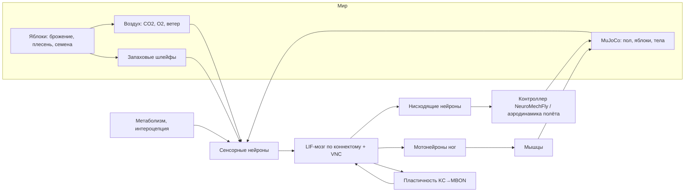

<h1 align="center">Fly-Sim</h1>

<p align="center">
<b>Дрозофилы с полными коннектомами в физических телах, живущие рядом с гниющими яблоками.</b><br>
Спайковые модели целых нервных систем <i>Drosophila</i> управляют телами NeuroMechFly в MuJoCo; в мире бродят и плесневеют фрукты, меняется воздух, сменяются сезоны, прорастают семена и растут деревья.<br>
Настройка, запуск и разбор — в браузере. Каждое приближение задокументировано.
</p>

<p align="center">


</p>

<p align="center"><a href="README.md">English</a> · <b>Русский</b></p>

---

## Оглавление

- [Что это](#что-это)
- [Что моделируется](#что-моделируется)
- [Быстрый старт](#быстрый-старт)
- [Как пользоваться сайтом](#как-пользоваться-сайтом)
- [Эксперименты и статистика](#эксперименты-и-статистика)
- [Логи и данные](#логи-и-данные)
- [Научный статус](#научный-статус)
- [Архитектура](#архитектура)
- [Производительность](#производительность)
- [Данные, источники, лицензия](#данные-источники-лицензия)
- [Структура репозитория](#структура-репозитория)
- [Релизы](#релизы)

## Что это

Fly-Sim моделирует *Drosophila melanogaster*, поведением которых управляют спайковые симуляции их
полных реконструированных нервных систем. Мухи воспринимают мир только через сенсорные нейроны,
которые есть в коннектоме, и действуют только через нисходящие и моторные нейроны с известной
функцией. Голод, кормление, избегание, обучение, спаривание, откладка яиц, старение и смерть
должны возникать из проводки, тела и среды, а не из сценариев.

Где данных нет, используются задокументированные приближения — каждое с источником в
[ASSUMPTIONS.md](ASSUMPTIONS.md). Каждый результат помечен **режимом механизмов**:
`connectome_only`, `connectome_plus_approximations` или `experimental_shortcuts`.
Что моделируется и что нет — [MODEL_SCOPE.md](MODEL_SCOPE.md); что проверено —
[SCIENTIFIC_VALIDATION.md](SCIENTIFIC_VALIDATION.md); открытые проблемы —
[KNOWN_ISSUES.md](KNOWN_ISSUES.md).

## Что моделируется

### Нервные системы

| | Самка | Самец | Эталон (не живёт в мире) |
|---|---|---|---|
| Коннектом | BANC 888 | Janelia Male CNS v1.0 | FlyWire v783 |
| Состав | мозг + зрительные доли + брюшная нервная цепочка | мозг + зрительные доли + брюшная нервная цепочка | мозг + зрительные доли |
| Нейроны / связи | 181 627 id (≈145 тыс. действующих: глия, трахеи, неаннотированные и нейроны без медиатора молчат) / 13,6 млн | 164 587 (≈163,6 тыс. действующих) / 25,6 млн | 138 639 / 15,1 млн |
| Калибровка | по типам клеток к FlyWire (мозг) / Male CNS (VNC) | по типам клеток к FlyWire (мозг), ×1/1,78 (VNC) | Shiu et al. 2024, проверено спайк в спайк |

У обоих полов полная центральная нервная система. FlyWire нужен для проверки симулятора и
калибровки типов клеток; в мир он не выпускается. Калибровка — это подгонка: она масштабирует
нейроны по типам и тем самым сглаживает половые различия силы входа; нейроны, по которым идут
проверки (MN9, PPL1, PAM, MBON, проверяемые PN), из неё исключены (A09f,
`scripts/calibration_report.py`).

- **Модель нейрона:** LIF (Shiu et al. 2024), событийная и параллельная; повторяет опубликованную
  модель Brian2 спайк в спайк.
- **Биологические поправки:** медиаторы по известной идентичности и типу клеток; без быстрых
  синапсов дофамина, серотонина, октопамина; без запуска спайков через аксо-аксонные синапсы на
  сенсорные нейроны и клетки Кеньона. Без них опубликованная модель уходит в самоподдерживающийся
  режим.
- **Обучение:** пластичность KC → MBON под дофамином с учётом порядка событий (запах→наказание
  ослабляет, наказание→запах усиливает), с забыванием.

### Органы чувств

Обоняние (более 2000 обонятельных нейронов с профилями DoOR, CO₂, геосмин, cVA самцов, шлейфы по
ветру), вкус (сахар, вода, горечь, соль; водные нейроны чувствуют осмолярность), зрение
(фоторецепторы по колонкам глаза, трассировка сцены), температура (термосенсоры усиков и тепло
тела), слух (орган Джонстона, песня ухаживания), ветер (нейроны ветра органа Джонстона),
проприоцепция и боль ног (мухи с полной ЦНС), интероцепция (инсулиновые клетки, чувствительность
от голода).

### Тело и физика

- **NeuroMechFly v2 в MuJoCo:** шесть ног, 42 сустава с приводами, гравитация, трение, сцепление
  лапок, контакты с полом и каждым яблоком, столкновения мух.
- **Моторная цепочка (мухи с полной ЦНС):** нисходящие нейроны → брюшная цепочка → мотонейроны
  мышц ног → активация мышц → суставы, с обратной связью от проприоцепторов. Ритм шага даёт
  генератор NeuroMechFly: коннектомная брюшная цепочка его не создаёт (задокументировано).
- **Полёт:** квазистационарная аэродинамика, сопротивление, гравитация, свободное падение;
  стабилизация — рефлекторный слой.
- **Тепло:** температура тела из теплообмена с воздухом и полом.
- **Схема тела и травмы:** состояние и измеренная функция каждой ноги, крыла, усика и глаза.

### Мир

Несколько яблок (возраст, целое/надрезанное, размер, место), которые бродят, превращаются в
уксус и плесневеют; воздух контейнера (баланс CO₂/O₂ от плодов, микробов, почвы и мух, с
вентиляцией); неподвижный воздух контейнера или **климат сада** (положение солнца и свет для
50° с. ш., день и ночь, суточный ход температуры, марковская погода от ясной до грозы, ветер у
земли с порывами); сезоны; почва; семена, которым для прорастания нужна холодная
стратификация, — затем сеянцы и плодоносящие деревья; жизненный цикл от яйца до взрослой мухи;
индивидуальная смертность (старение по Гомперцу, голод, жара, холод, аноксия, токсин плесени).

## Быстрый старт

**Docker**

```bash
docker compose up --build
```

Откройте http://localhost:8800. При первом запуске скачается около 1,2 ГБ открытых данных
коннектомов в `./data`. Выделите Docker не меньше 6 ГБ памяти.

**Локально** (Python 3.12, macOS или Linux)

```bash
uv venv --python 3.12 .venv && uv pip install -e ".[validate]"
```

```bash
scripts/download_data.sh && .venv/bin/python -m flysim.live
```

## Как пользоваться сайтом

1. **Наблюдения** (главная): все идущие и сохранённые прогоны. Несколько прогонов могут идти
   одновременно; каждый можно открыть в своей вкладке; законченные можно удалить.
2. **Новое наблюдение:** *свободная симуляция* (размер мира в метрах, сезоны, почва, ветер, воздух,
   климат, яблоки, мухи, травмы, научные контроли, лимиты времени по желанию) или
   *готовый эксперимент* (протокол, группа, seed).
3. **Наблюдение:** арена (ночью темнее, стрелка ветра), погода и воздух, мозг каждой мухи целиком (каждый нейрон на реальном месте), внутреннее
   состояние, схема тела, химия яблок относительно нормы. Во время работы можно добавлять мух и
   яблоки. Любой момент можно повторить.
4. **Хроника (панель бога):** временная шкала всего обнаруженного — драки, ухаживание, спаривание,
   яйца, рождения и смерти с причинами, кормление, сигналы наказания и награды (нейронные
   корреляты), изменения памяти, стадии яблок, тревоги по воздуху, растения. Фильтры, раскрытие,
   копирование, переход к моменту. Для каждого события — какие области мозга преобладали и как шёл
   сигнал между областями; преобладание областей во времени по каждой мухе.
5. **Паспорта:** у каждой мухи уникальный ID, происхождение и родители, полнота нервной системы,
   режим механизмов, индивидуальная выносливость и история жизни.

Без лимита свободная симуляция идёт, пока в мире есть жизнь: взрослые мухи или потомство.

## Эксперименты и статистика

```bash
.venv/bin/python scripts/series.py list
```

```bash
.venv/bin/python scripts/series.py plan tmaze_choice 10
```

```bash
.venv/bin/python scripts/series.py run tmaze_choice 10 --proc 8
```

Протоколы задают гипотезу, группы и контроли (без пластичности, без обходов, только рефлексы).
Анализ даёт средние, 95 % доверительные интервалы, Cohen's d, тесты Уэлча и Манна–Уитни и число
повторов для мощности 80 %. Каждый прогон воспроизводится по ID эксперимента и `manifest.json`.
См. [EXPERIMENT_DESIGN.md](EXPERIMENT_DESIGN.md).

## Логи и данные

В папке каждого прогона (`results/runs/<id>/`): `frames.jsonl` (вся история: положения каждые
0,1 с, спайки всего мозга раз в секунду и вокруг событий), `events.jsonl`/`events.txt`,
`timeseries.csv` (состояния, нейронные показатели, моторные команды и движение тела),
`apple.csv` и `manifest.json` (версия модели, режим механизмов, полнота нервной системы,
условия). Частоты нейронов награды и наказания — функциональные нейронные корреляты, а не
измерение переживаний.

## Научный статус

Проверено: точное воспроизведение эталонной модели; сахар → моторный нейрон кормления и
подавление горечью; устойчивость сети; CO₂ врождённо включает дофамин наказания; голод усиливает
кормление в замкнутой петле (это проверка ручного усиления сахарных рецепторов A14 и порога
хоботка, а не эмерджентное свойство); пластичность с учётом порядка событий; самка BANC близка к эталону FlyWire
на тестах сахара, запахов и устойчивости; болевой сигнал ног доходит до дофамина наказания через
полную ЦНС. Различия между данными разобраны, а не подогнаны: у самца путь CO₂ → дофамин
наказания молчит из-за проводки, у BANC горечь подавляет кормление слабее (KNOWN_ISSUES #6).
Открыто: ухаживание и агрессия пока не возникают; брюшная цепочка не даёт ритма шага;
устойчивость антеннальной доли держится на одной, вероятно ошибочной, метке медиатора
(KNOWN_ISSUES #5). Метакогниция не добавляется отдельным модулем: если она у мух есть, она должна
возникнуть из самого симулируемого коннектома, поэтому отслеживаются только возможные индикаторы.

## Архитектура



## Производительность

На 8-ядерном процессоре ноутбука: один мозг ≈ 1,7 с счёта на 1 с модельного времени; пара мух с
телами NeuroMechFly ≈ 15–20 с на 1 с. Память ≈ 0,4 ГБ на муху. Серии с повторами
масштабируются по числу процессов.

## Данные, источники, лицензия

Код — MIT ([LICENSE](LICENSE)). Данные скачиваются из источников и остаются под своими
лицензиями ([NOTICE.md](NOTICE.md)): FlyWire (Dorkenwald et al. 2024; Schlegel et al. 2024),
Shiu et al. 2024, Janelia Male CNS v1.0, BANC (Bates et al. 2025), Matsliah et al. 2024, DoOR
(Münch & Galizia 2016), NeuroMechFly v2 (Wang-Chen et al. 2024).

## Структура репозитория

```
flysim/brain      спайковый симулятор, пластичность, сборка мозга и калибровка
flysim/data       загрузчики FlyWire, BANC и Male CNS, разметка
flysim/agent      органы чувств, метаболизм, моторика, моторная цепочка, тела, физика, смертность
flysim/world      яблоки, атмосфера, погода, растения, популяция, мир
flysim/sim        эксперименты, протоколы, хроника, журнал событий, происхождение результатов
flysim/live       сайт (компоненты Lit в flysim/live/static)
scripts           загрузка данных, проверки, серии, пробы
```

## Релизы

| Версия | Что внутри |
|---|---|
| 0.4.0 | Самка всегда с полной ЦНС (BANC), климат сада (день и ночь, погода, порывистый ветер), новый дизайн сайта (Lit), удаление прогонов, одинаковый вид мозга у всех, разбор расхождений между данными, научный аудит |
| 0.3.0 | Сайт с несколькими прогонами и панелью бога (хроника, динамика областей мозга, паспорта), готовые эксперименты из браузера, самка BANC с калибровкой по типам, путь боли через полную ЦНС, индивидуальная смертность и естественный конец, ветер и дыхание почвы, лицензия MIT |
| 0.2.0 | Режимы механизмов и происхождение результатов, протоколы и статистика, моторная цепочка самца, самка BANC, схема тела, несколько яблок, деревья, сезоны |
| 0.1.0 | Мозги по коннектомам, тела NeuroMechFly, физика, гниющее яблоко, атмосфера, обучение, размножение, сайт, Docker |
